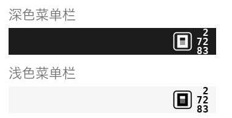
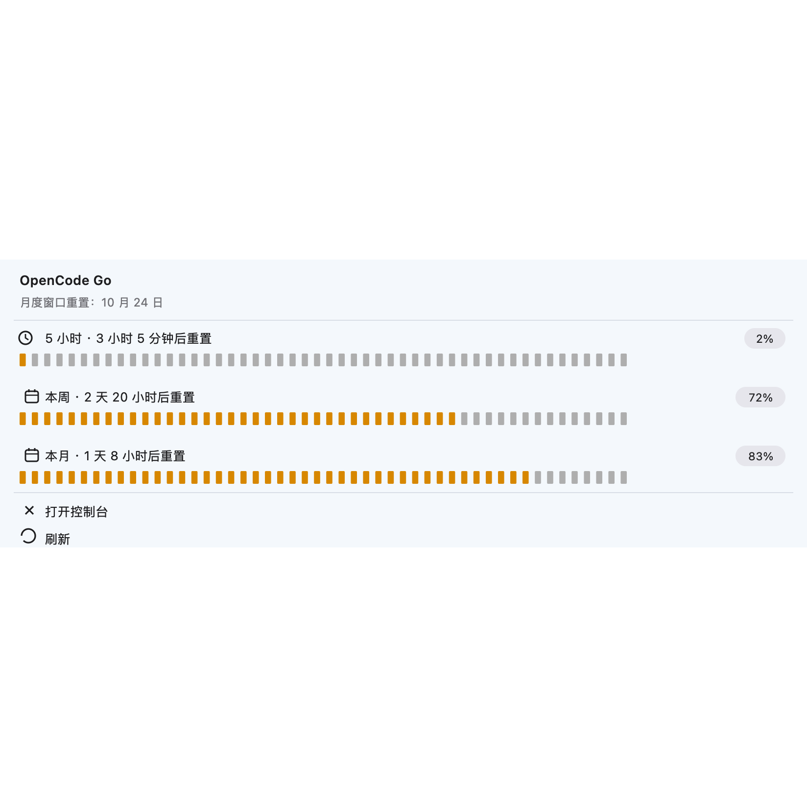

# OpenCode Usage for SwiftBar · OpenCode 额度菜单栏 📊

Your OpenCode quota in the macOS menu bar: the 5-hour / weekly / monthly windows at a glance, with a heads-up before you run out ⏰

把 OpenCode 的额度放进 macOS 菜单栏：三档用量一目了然，快用完时还会主动提醒。

## 🖥️ How it looks · 菜单栏里的样子





[中文说明](README.zh-CN.md)

## ✨ Features · 功能

- 📊 **Live quota for all three windows · 三档额度实时显示**
  A 50-tick meter per window, colour-coded 🟢 green → 🟠 amber at 60% → 🔴 red at 85%; the exact percentage sits in a pill on the right.
  刻度条按紧张程度变色，精确百分比在右侧胶囊里。
- 🔔 **Heads-up before you run out · 快用完时提醒**
  A macOS notification when any window crosses 85% — once per window per cycle, never a barrage.
  任一档越过 85% 发一条系统通知，每档每个周期只提醒一次。
- 🏃 **Pace warning · 进度提示**
  Burning a window faster than the clock turns it red and marks it "ahead of pace".
  用得比时间流逝明显快时，该档标红并注明「进度偏快」。
- ⚡ **Zen detected automatically · Zen 自动识别**
  A key with no Go windows switches to the Zen (pay as you go) card.
  key 没有 Go 窗口时自动切换成 Zen 卡片。
- 🔑 **Multiple keys, with names · 多把 Key，可以起名**
  Call them "personal" and "work", switch from the menu.
  「个人」「工作」随便叫，菜单里一点就切换。
- 🌍 **Seven languages · 七种语言**
  简体中文 / 繁體中文 / English / 日本語 / 한국어 / Español / Français — applied instantly.
- ☁️ **Offline-proof · 断网不掉数据**
  When a read fails, the last good reading stays on screen, labelled with its age.
  读取失败时继续显示上一次的读数，并注明是多久前的。

## 📦 Requirements · 环境要求

- 🍎 macOS + [SwiftBar](https://github.com/swiftbar/SwiftBar)
- 🐍 python3 — optional Pillow (without it the menu bar icon falls back to plain text)
  可选 Pillow：没有时菜单栏图标会退化成文字，其余功能不受影响

## 🚀 Install · 安装

```bash
git clone https://github.com/Nick0112a/opencode-usage-swiftbar.git
cd opencode-usage-swiftbar
./install.sh
```

## 🪄 First run · 第一次使用

1. 🖱️ Click the new menu bar item · 点开菜单栏的新图标
2. 📋 "API Key ▸ Add key ▸ From clipboard…" — copy your key from the OpenCode console first · 先在 OpenCode 后台复制好你的 key
3. ✅ Done! It refreshes itself every 5 minutes · 之后每 5 分钟自动刷新

## 🖥️ The menu · 菜单里有什么

| Item | What it does · 说明 |
|---|---|
| 📊 Three windows + meters 三档用量 | The percentage sits in the pill; click any row to open the dashboard · 点任意一行可打开控制台 |
| 🔑 API Key ▸ | Every saved key (ticked = live); rename, add, remove · 已存的 key，可起名、新增、删除 |
| 🌍 Language 语言 ▸ | Seven languages, applied instantly · 即点即换 |
| 🎛️ Open dashboard / Refresh | Jump to the console / force a refresh · 打开后台 / 立即刷新 |

## ❓ FAQ

- **Where do the dollar caps come from? 美元上限哪来的？**
  The documented standard Go limits ($12 / $30 / $60); the API only returns percentages, and Go Plus differs — hence the ≈
  官方文档的标准 Go 额度；接口只返回百分比，Go Plus 不同，所以写 ≈。
- **No notification? 通知没弹？**
  macOS asks for permission the first time one fires 🔔
  第一次触发时系统会请求通知权限，允许即可。
- **Why doesn't the meter reach the menu edge? 刻度条没到最右边？**
  That last bit is the menu's own margin · 那是菜单自带的边距

## ⚠️ Known limits · 已知限制

- Built on two undocumented endpoints the web console uses; if their shape changes you'll see the cached reading and an explicit error, never a crash
  依赖网页控制台的两个未公开接口，结构变化时会显示缓存读数并明确报错，不会崩
- The dollar caps are documentation values; the API only returns percentages
  美元上限是文档标注值，接口只返回百分比
- macOS only · 仅支持 macOS

Before hacking on the plugin, read [DEVELOPMENT.md](DEVELOPMENT.md) — it documents the SwiftBar behaviours that are easy to walk back into.
改这个插件之前先读 [DEVELOPMENT.md](DEVELOPMENT.md)，里面是 SwiftBar 的几个反直觉行为。

## 📄 License

MIT
